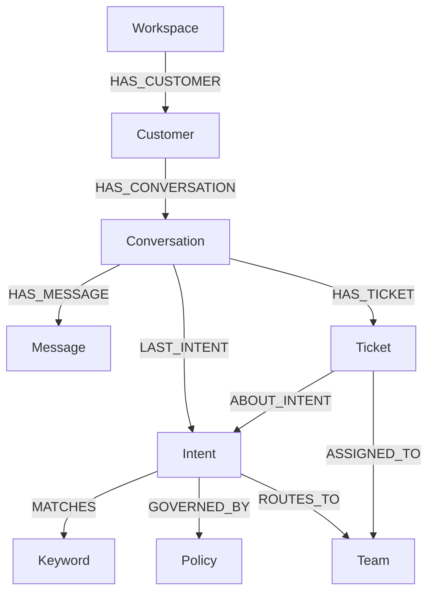

# Graphline — ANTIINTERNS

**A FalkorDB-first support agent that uses connected customer context to answer, route and remember.**

Graphline is a standalone Graph Hacks prototype inspired by the WhatsApp support workflow in the ANTIINTERNS platform. It is separate from that pre-existing application. This new app uses FalkorDB as its only application database: conversations, messages, customer links, intent matching, policy guidance, team routing and tickets are all stored and queried in the graph.

## What it does

1. A customer message is saved as a graph `Message` connected to its `Conversation` and `Customer`.
2. The agent matches words in the message to `Keyword` nodes connected to `Intent` nodes. The winning intent is chosen by the number of matching graph keywords.
3. A multi-hop Cypher query follows the intent to its `Policy` and `Team`.
4. The agent uses the policy response from FalkorDB. If the graph marks the intent for human handling, it creates a `Ticket` node and assigns it to the connected team.
5. Prior conversations connected to the same customer are retrieved as persistent memory.
6. The interface displays the actual graph-derived reasoning path for each action.

Intent, policy, route, memory and ticket decisions are deterministic graph operations. By default, the reply uses wording stored in the graph. Optionally, OpenRouter can rewrite that reply within the retrieved policy; it cannot change the graph's routing or ticket decision. The sample workspace is synthetic. No WhatsApp messages, personal data, login-protected data, API keys, or user screenshots are imported.

## Hackathon tracks

- **Agents That Act on Connected Data** — an agent uses multi-hop graph context to select a policy, route a case and create a ticket.
- **Agent Memory and Coordination** — customer conversation history persists as graph memory, and the graph routes work to the right team.

The demo implements these two tracks. It does not claim a full Company Brain product.

## Run locally

Requirements: Docker Desktop (or Docker Engine with Compose) and Node.js 20+.

```bash
docker compose up -d
npm start
```

Open [http://localhost:4173](http://localhost:4173). FalkorDB's browser UI is available at [http://localhost:3000](http://localhost:3000) if enabled by the selected image.

The server waits for FalkorDB, creates the `antiinterns_support` graph and idempotently seeds a few clearly synthetic example conversations, policies, intents and teams. Press **New conversation** to create a new synthetic customer, then use the sample message buttons or type a message. A matched human handoff creates a ticket and assigns it to a team in FalkorDB.

To enable optional OpenRouter reply drafting, set `OPENROUTER_API_KEY` in the process environment before `npm start`. The default model is `openrouter/free`; it routes to an available free model, whose availability and behavior can vary. Set `OPENROUTER_MODEL` to another model ID if desired. When enabled, OpenRouter receives the current message and graph-retrieved customer context. Use only synthetic demo content unless you have permission to send other data. Without a key, the application uses the graph-stored reply wording. Provider usage may incur charges depending on model and account; free-model availability is not guaranteed.

To change the database connection, set `FALKORDB_HOST`, `FALKORDB_PORT`, `FALKORDB_PASSWORD`, and optionally `FALKORDB_GRAPH`. The defaults work with the supplied Compose file. `PORT` changes the web port.

To stop the demo while preserving graph data:

```bash
docker compose down
```

To remove the demo graph data too:

```bash
docker compose down -v
```

## Demo assets

- [`demo.mp4`](demo.mp4) is a short, captioned walkthrough assembled from real screenshots of this local app after exercising delivery routing, refund ticket creation and cross-conversation memory.
- [`screenshots/`](screenshots/) contains the captured inbox and action states; every record shown is synthetic.
- Re-capture screenshots on macOS with `node tools/capture-demo.js` while the app is running. Rebuild the MP4 with `./tools/build-demo-video.sh` (requires FFmpeg, Python 3 and Pillow).

## Graph model



The seed also links each conversation back to its customer with `FOR_CUSTOMER`, so a query can traverse from the active conversation to that customer's earlier conversations and messages. `Workspace` is present as the sample workspace marker.

### Why FalkorDB is central

FalkorDB is the source of truth for every record the prototype operates on. Message classification reads `Intent-[:MATCHES]->Keyword`; response selection traverses `Intent-[:GOVERNED_BY]->Policy`; routing traverses `Intent-[:ROUTES_TO]->Team`; tickets are persisted as connected graph nodes; and cross-conversation memory traverses `Customer-[:HAS_CONVERSATION]->Conversation-[:HAS_MESSAGE]->Message`. Removing FalkorDB removes the inbox data, decision context, memory, response policy and ticket actions. There is no parallel SQL, MongoDB, file, or in-memory data store.

## Cypher the product depends on

Executable source is in [`server.js`](server.js). The core patterns are documented in [`docs/graph-queries.md`](docs/graph-queries.md), including graph keyword matching, policy/team retrieval, ticket writes, customer memory and inbox loading.

## Architecture and limits

- Node.js built-in HTTP server serves the interface and API; no web framework or application database is required.
- A small RESP client sends `GRAPH.QUERY` commands directly to FalkorDB over its Redis-compatible protocol.
- The graph decides intent, policy, routing, ticket creation and memory. OpenRouter is optional and only drafts the reply text from that graph context.
- The browser displays graph-derived conversations, counts, memory and decision paths. Those are queried from FalkorDB, not hard-coded dashboard totals.
- This prototype does not connect to WhatsApp or send messages outside the local demo. A real channel adapter and business-approved policies would be separate integration work.
- The seeded names, addresses and messages are fictitious `.example.test` demo data and visibly labeled synthetic in the interface.

## AI coding assistant disclosure

OpenAI Codex assisted with implementation and documentation. The project owner must review and understand the graph model, Cypher operations, decision logic, and runtime architecture before submitting or presenting the project. The code and decisions are described in [`SUBMISSION_NOTES.md`](SUBMISSION_NOTES.md).

## Hackathon timing and provenance

The original WhatsApp automation platform predates this standalone entry and is not presented as hackathon-created work. This FalkorDB-first Graphline prototype is a separate implementation started on **18 October 2026** for the Graph Hacks submission. Preserve the project history and be prepared to explain the distinction. Confirm the organizer's current eligibility interpretation before submission if any earlier work on this prototype exists outside this folder.

Official event rules: [Graph Hacks by WeMakeDevs and FalkorDB](https://www.wemakedevs.org/hackathons/falkordb). The event rules require the main FalkorDB implementation to be new work during the event, a public source repository, the graph model and Cypher queries, a working demo video, local setup instructions if not deployed, named track(s), and disclosure of AI coding assistance. This folder contains the source, local setup, queries, tracks and demo video; it is not yet published as a public repository.

## License

This prototype is provided for hackathon evaluation. The original WhatsApp platform is separate and has its own license and authorship.
